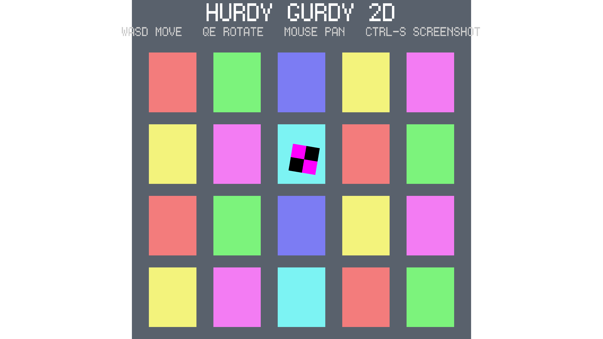
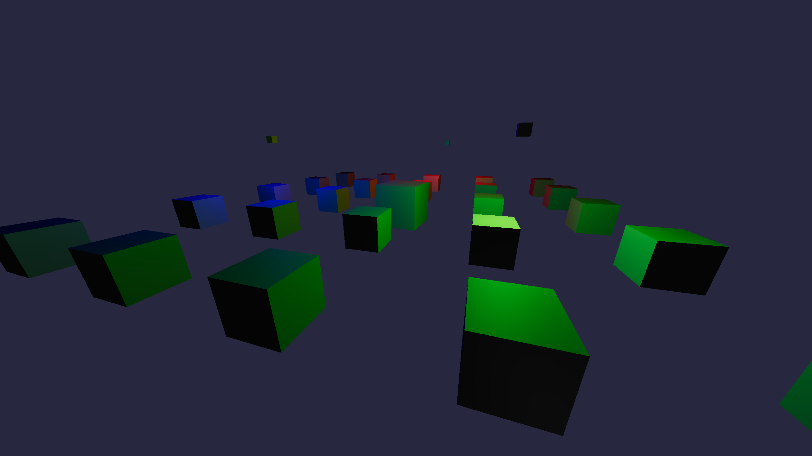

# Hurdy Gurdy


Hurdy Gurdy is a modern C++20 game development library. I mostly
wrote it for fun and learning, but it should be usable to write real games. Most
subsystems are pretty modular, so use what you like, and not what you don't.

<p align="center">
  
  
</p>

## Feature List

TODO

## Quickstart

```cpp
#include <hurdygurdy.hpp>

using namespace hg;

int main()
{
    std::unique_ptr<InputDevice> input = InputDevice::create();
    if (input == nullptr)
        panic("Could not create input device: {}\n", std::string{getError()}.c_str());

    std::unique_ptr<Gpu> gpu = Gpu::create(input->getVulkanExtensions());
    if (gpu == nullptr)
        panic("Could not initialize GPU: {}\n", std::string{getError()}.c_str());

    std::unique_ptr<Window> window = input->createWindow(gpu.get(), {});
    if (window == nullptr)
        panic("Could not create window: {}\n", std::string{getError()}.c_str());
    window->setTitle("Hello Hurdy Gurdy");

    Renderer2D renderer{gpu.get(), window->swapchainFormat()};

    Camera camera{Orthographic{{{0, 0}, {1.6f, 1.0f}}}};
    Layer2D layer{};

    for (;;)
    {
        input->processEvents();
        if (input->wasQuit() || window->wasClosed())
            break;

        layer.clear();
        layer.drawRect({0.1f, 0.12f, 0.15f, 1.0f}, {Vec2{0, 0}, Vec2{1.6f, 1.0f}});

        layer.drawText("Hello, Hurdy Gurdy!", {1.0f, 1.0f, 1.0f, 1.0f},
            TextBuilder2D{getDefaultFont()}
                .setTopCenter({0.8f, 0.4f})
                .setHeight(0.1f));

        renderer.drawLayer(layer);

        Window* windows[] = {window.get()};
        std::unique_ptr<GpuCommandBuffer> cmd = gpu->beginFrame(windows);

        if (window->currentView() != nullptr)
        {
            GpuAttachment colorAttachment{};
            colorAttachment.image = window->currentView();

            GpuPass pass{};
            pass.colorAttachments = {&colorAttachment, 1};

            cmd->beginRenderPass(pass);
            renderer.render(cmd.get(), camera);
            cmd->endRenderPass();
        }
        gpu->endFrame(std::move(cmd));
    }

    gpu->waitIdle();
}
```

Complete runnable versions live in [examples/example2d.cpp](examples/example2d.cpp) and
[examples/example3d.cpp](examples/example3d.cpp).

## Integration

All three methods make the `hurdygurdy::hurdygurdy` target available:

```cmake CMakeLists.txt
target_link_libraries(my_game PRIVATE hurdygurdy::hurdygurdy)
```

With [FetchContent](https://cmake.org/cmake/help/latest/module/FetchContent.html):

```cmake CMakeLists.txt
include(FetchContent)
FetchContent_Declare(hurdygurdy
    GIT_REPOSITORY https://github.com/CooperHerlihy/hurdygurdy
    GIT_TAG        main
)
FetchContent_MakeAvailable(hurdygurdy)
```

With an installed copy:

```bash
git clone https://github.com/CooperHerlihy/hurdygurdy
cmake -S hurdygurdy -B hurdygurdy/build -DCMAKE_BUILD_TYPE=Release
cmake --install hurdygurdy/build --prefix /path/to/prefix
```

```cmake CMakeLists.txt
find_package(hurdygurdy REQUIRED)
```

Configure your project with `-DCMAKE_PREFIX_PATH=/path/to/prefix` so CMake can
find the package. Or, with a plain checkout:

```cmake CMakeLists.txt
add_subdirectory(path/to/hurdygurdy)
```

As a subproject or through FetchContent, tests, examples and install rules are
disabled by default. Enable them if needed:

```cmake
set(HG_BUILD_TESTS ON CACHE BOOL "" FORCE)
set(HG_BUILD_EXAMPLES ON CACHE BOOL "" FORCE)
```

## Options

| Option | Default | Description |
| --- | --- | --- |
| `HG_BUILD_TESTS` | top-level: `ON`, subproject: `OFF` | Build the test suite |
| `HG_BUILD_EXAMPLES` | top-level: `ON`, subproject: `OFF` | Build `example2d`, `example3d` and `platform_test` |
| `HG_INSTALL` | top-level: `ON`, subproject: `OFF` | Generate install and CMake package rules |
| `HG_USE_SDL` | `OFF` | Use the SDL backend instead of the native platform backends |
| `HG_USE_CCACHE` | `OFF` | Use ccache as the compiler launcher |
| `HG_USE_MOLD` | `OFF` | Link with mold (non-MSVC) |

## Building

### Dependencies

- C++20 compiler (Clang 19+, GCC 15+, or MSVC)
- CMake (3.21+)
- SPIR-V compiler (glslc, included in LunarG Vulkan SDK)
- Windows only: Windows SDK (installed with Visual Studio)
- Debugging only: Vulkan Validation Layers (included in LunarG Vulkan SDK)

On Nix, `nix develop` provides all dependencies.

### Compilation

```bash
# Linux:
cmake -B build -DCMAKE_BUILD_TYPE=Release
cmake --build build

# Windows: open a Visual Studio 2022 x64 developer shell first, then:
cmake -B build -DCMAKE_BUILD_TYPE=Release
cmake --build build
```

On Nix, `nix build` compiles a standalone release build of the library, and the
`nix develop` shell provides scripts that build everything with ccache and mold
enabled:

```bash
debug     # Debug build and run tests
release   # Release build and run tests
san       # Address + UB sanitizer build and run tests
tsan      # Thread sanitizer build and run tests
```

### Testing

Tests and examples are built together when hurdygurdy is the top-level project:

```bash
cmake -B build -DCMAKE_BUILD_TYPE=Debug -DHG_BUILD_TESTS=ON -DHG_BUILD_EXAMPLES=ON
cmake --build build

./build/tests
./build/example2d
./build/example3d
```

Both examples save a screenshot with Ctrl-S.

